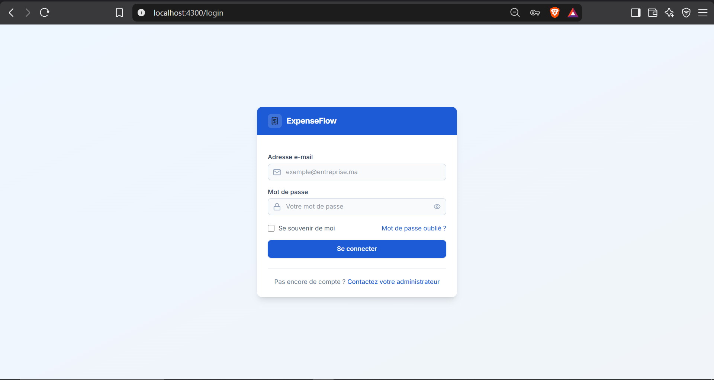
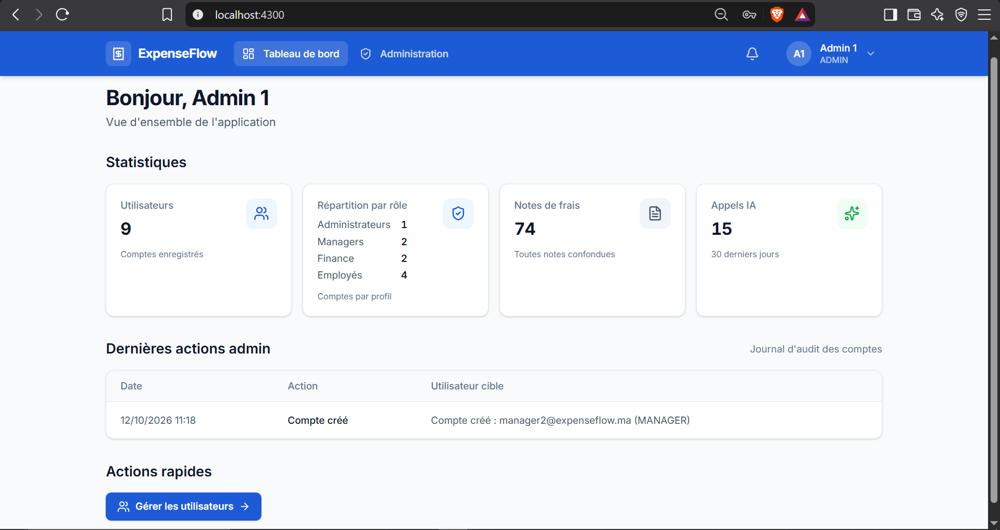
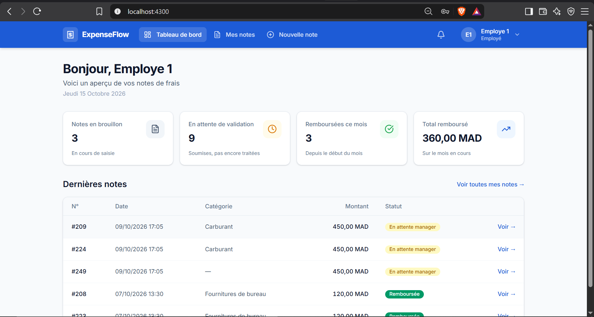
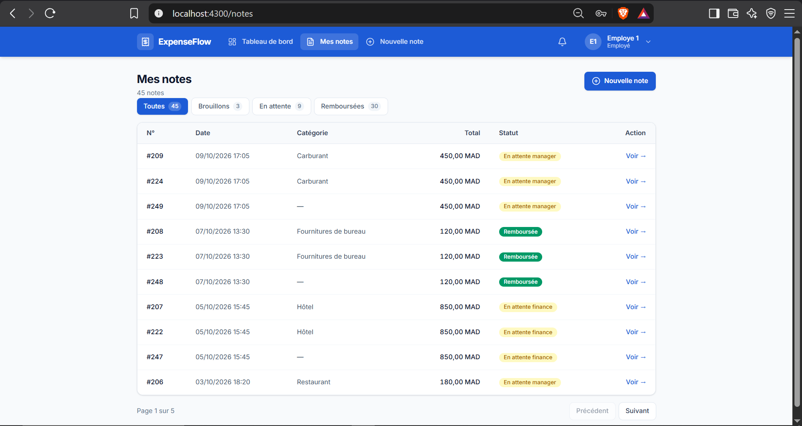
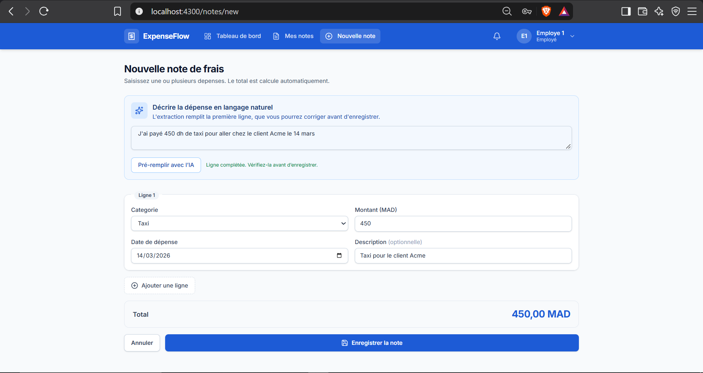
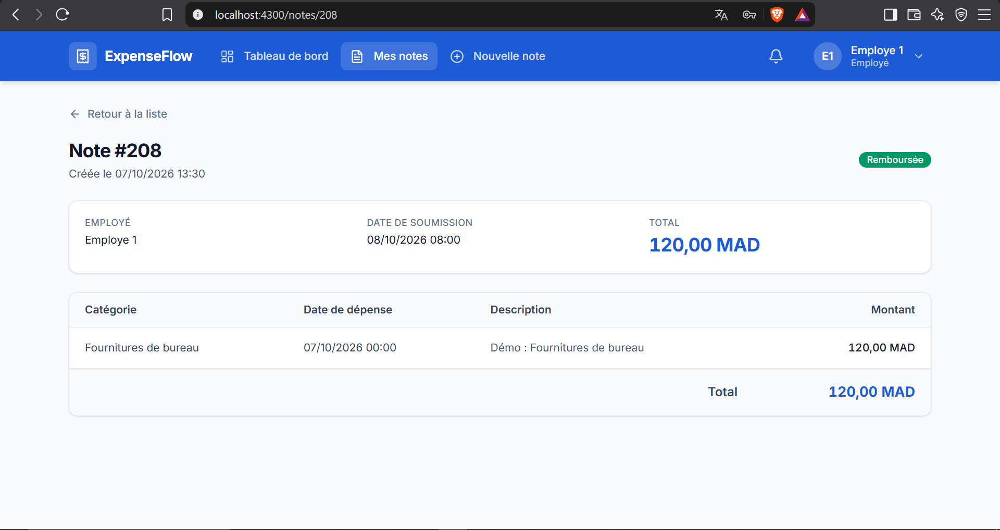
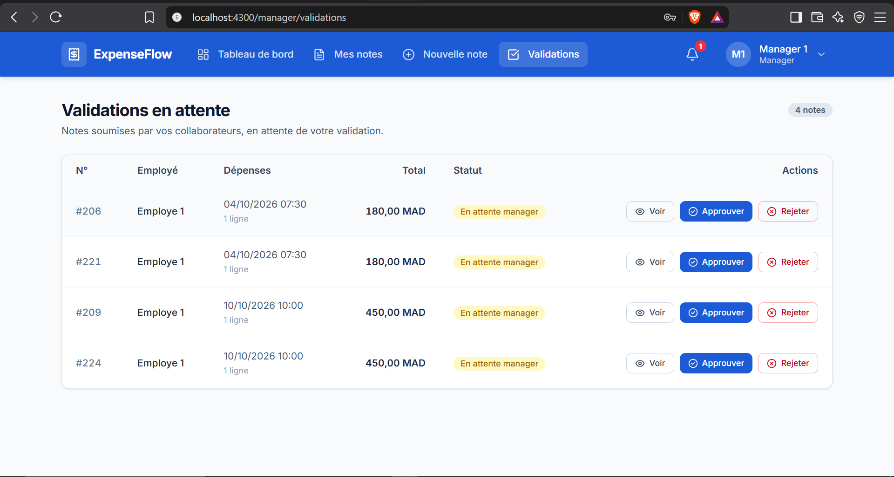
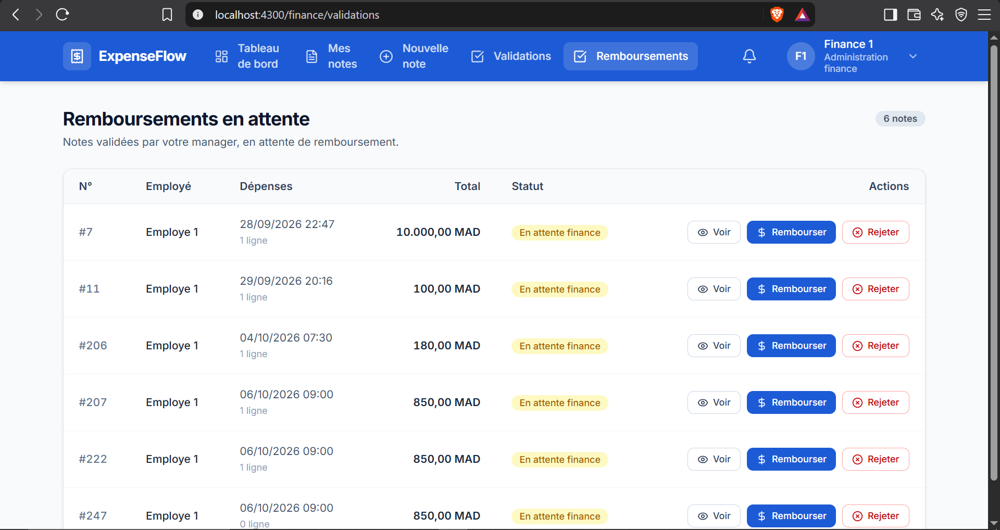
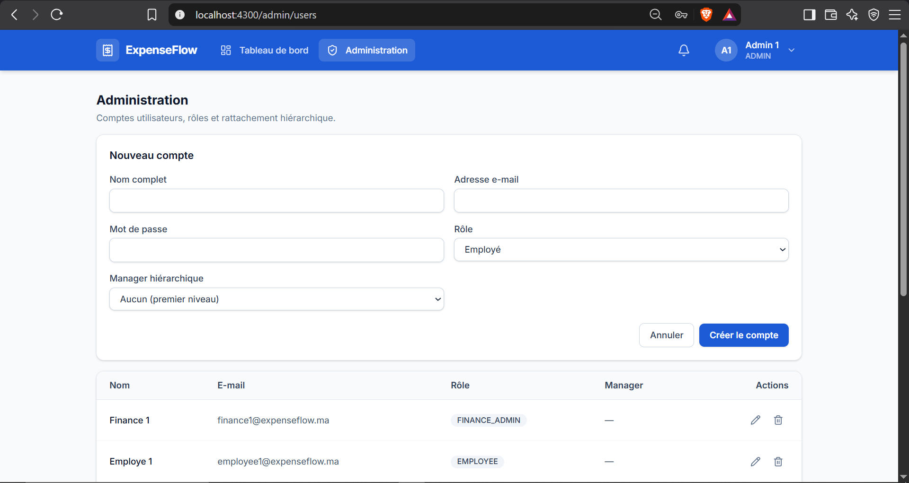
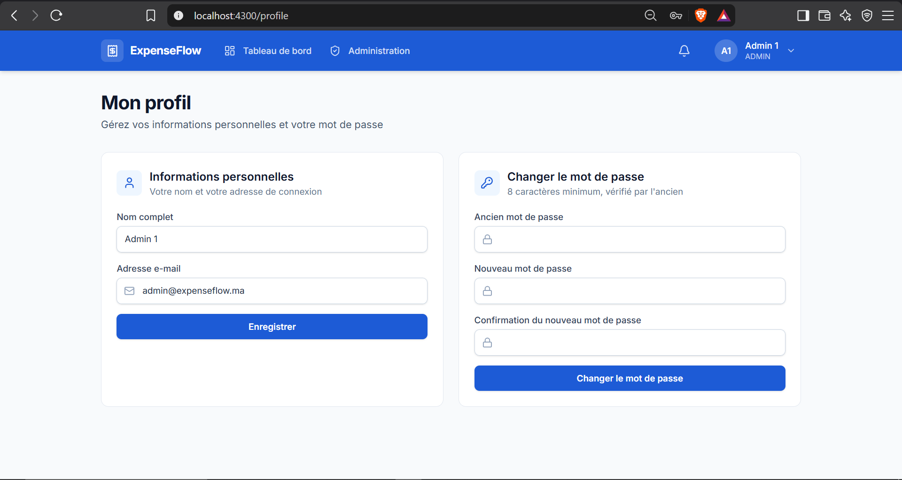

# ExpenseFlow

Application web de gestion des notes de frais B2B, projet personnel réalisé
pendant mon Master 2 Systèmes d'Information & IA (2026). Un employé décrit sa
dépense en français courant, l'IA pré-remplit le formulaire, le manager valide,
la finance rembourse : 8 états, notifications in-app.

## Projet réalisé en 2026 et publié sur GitHub en octobre 2026 : l'historique Git commence à la publication.

## Fonctionnalités

- Authentification JWT (HS256, 1 h) et 4 rôles : `EMPLOYEE`, `MANAGER`,
  `FINANCE_ADMIN`, `ADMIN` — contrôle d'accès côté serveur.
- Workflow sur 8 états (`DRAFT` → `REIMBURSED`, + deux branches de rejet),
  machine à états pure et exhaustivement testée.
- Extraction de dépense en langage naturel via Groq (« 450 dh de taxi pour le
  client Acme le 14 mars » → formulaire pré-rempli, re-validé côté serveur).
- Plafonds budgétaires par catégorie × rôle, contrôlés à la soumission (409).
- Journal des appels IA (tokens, coût).
- Changement de mot de passe forcé à la première connexion (comptes créés par
  un administrateur).

## Stack

| Couche | Choix |
|---|---|
| Backend | Java 21, Spring Boot 4.1, Spring Security (JWT HS256) |
| Base | PostgreSQL 16, Flyway (V1→V6), Spring Data JPA |
| Frontend | React 18, Vite 8, Tailwind CSS 4, Zustand, RHF + Zod |
| IA | Groq — `openai/gpt-oss-120b` |
| Tests | JUnit 5, Mockito, Testcontainers — **565 tests** |
| Infra | Docker Compose (postgres + API + nginx), ESLint 9 |

## Démarrage rapide

```bash
git clone https://github.com/otman-aml/expenseflow.git && cd expenseflow
cp .env.example .env   # renseigner GROQ_API_KEY et JWT_SECRET (obligatoires)
docker compose up -d --build
```

| Service | URL |
|---|---|
| Application | http://localhost:4300 |
| Swagger | http://localhost:8090/swagger-ui/index.html |

Développement local : `docker compose up -d postgres`, puis
`cd backend && ./mvnw spring-boot:run` et `cd frontend && npm run dev`.

## Comptes de démonstration

Le script `backend/src/main/resources/db/seed/demo-data.sql` crée 5 comptes
(mot de passe `Password123!`) et 15 notes réalistes, rejouable à volonté :

```bash
docker exec -i expenseflow-postgres psql -U expenseflow -d expenseflow \
  < backend/src/main/resources/db/seed/demo-data.sql
```

| Rôle | Email |
|---|---|
| `EMPLOYEE` | employee@expenseflow.ma |
| `MANAGER` | manager@expenseflow.ma |
| `FINANCE_ADMIN` | finance@expenseflow.ma |
| `ADMIN` | admin@expenseflow.ma |
| `ADMIN` (secours) | admin2@expenseflow.ma |

## Architecture

Trois conteneurs : PostgreSQL 16 (5434), l'API Spring Boot (8090) et le front
React servi par nginx (4300), qui relaie `/api/*` vers le backend. Flyway
applique les 6 migrations au démarrage ; Hibernate valide le schéma
(`ddl-auto=validate`). Les secrets n'arrivent que par variables
d'environnement : `docker compose up` échoue explicitement s'ils manquent.
Les 8 diagrammes UML (PlantUML + rendus PNG/SVG) sont dans
[`docs/diagrams/png/`](docs/diagrams/png/).

## Tests

```bash
cd backend  && ./mvnw test   # 565 tests — Docker requis (Testcontainers)
cd frontend && npm run lint  # ESLint 9
cd frontend && npm run build # build de production
```

Déploiement (Neon → Render → Vercel) : [`DEPLOYMENT.md`](DEPLOYMENT.md).

## Captures d'écran

### Login


### Dashboard admin


### Dashboard employé


### Liste des notes


### Formulaire de note (IA)


### Détail d'une note


### Validations manager


### Validations finance


### Administration des comptes


### Profil


---

## Problèmes connus

1. **Notifications envoyées à tous les managers**, alors que la file de
   validation est filtrée par équipe — visible dès qu'il y a deux équipes.
2. **Pas de refresh token** : le JWT expire après 1 h et l'utilisateur est
   déconnecté sans prévenir, y compris au milieu d'une saisie.
3. **Pas de pagination serveur** sur la liste des notes : tout est renvoyé
   d'un bloc — acceptable à l'échelle actuelle, problématique à 10 000 notes.
4. **Suppression d'un compte manager** sans traitement explicite du sort de
   ses employés (`users.manager_id` orphelin).

## Dépannage

- **Les ports répondent en `LISTENING` mais l'application ne répond pas** :
  c'est un classique de Docker Desktop / WSL 2. Le port peut être tenu par
  un *port-forwarder* résiduel alors que la pile est morte — vérifier
  `docker ps` avant de soupçonner l'application. Si le daemon ne répond plus
  : `wsl --shutdown`, relancer Docker Desktop, `docker compose up -d`.

## Limites de l'extraction IA

- **Confidentialité** : les descriptions de dépenses sont envoyées à un service
  externe (Groq). Point d'attention pour la confidentialité des données
  (loi 09-08, CNDP). Alternative envisagée : modèle local (Ollama).
- **Fiabilité** : le LLM peut se tromper. La sortie est re-validée côté
  serveur (montant > 0, catégorie existe, date non future) et l'employé
  confirme le formulaire avant soumission.
- **Performance** : non mesurée sur un jeu de test à ce jour — le taux de
  remplissage correct des champs reste à établir sur un corpus de phrases
  réelles.
  
## Choix discutables

1. **JWT porté en `Authorization`, gardé en mémoire** : pas de persistance
   dans `localStorage`, mais le token reste exposé à un XSS actif ; impose
   une reconnexion au refresh de page. Alternative : cookie `httpOnly` +
   protection CSRF.
2. **`notification_type` en `VARCHAR`** plutôt qu'enum SQL : évolution sans
   migration, au prix d'une contrainte non vérifiable en base.
3. **Plafonds par ligne et non par mois** : un total mensuel cumulé peut
   dépasser l'esprit de la politique sans déclencher rien.
4. **CSRF désactivé** : cohérent avec une API stateless sans cookies, à
   réviser si le front adopte des cookies.
5. **Aucun test front** : la qualité du front repose sur ESLint et le build,
   rien de plus.

## Ce que je ferais différemment

1. **Des tests front dès le départ** — 565 tests côté backend, 0 côté front :
   cette asymétrie est le premier chantier d'une v2.
2. **Pagination et filtres serveur dès la première itération** — le passage en
   `page`/`size` casse toutes les pages une fois les données réelles là.
3. **Provisionner les comptes de démo par un seed versionné dès le début** —
   un compte admin supprimé manuellement a failli rendre le dépôt non
   démontrable ; le seed actuel est né de cet incident.
