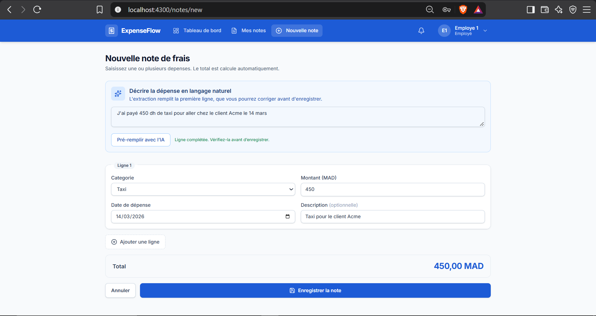
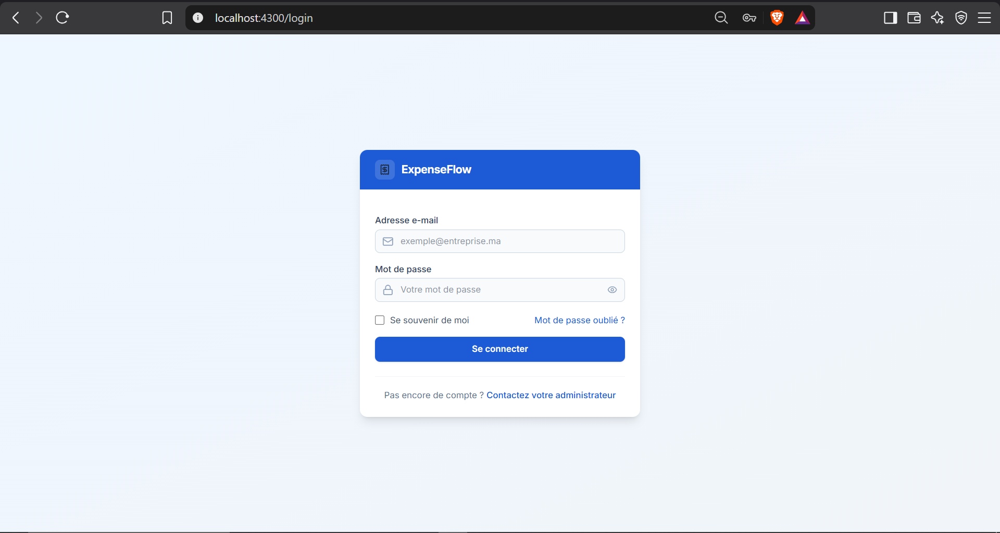
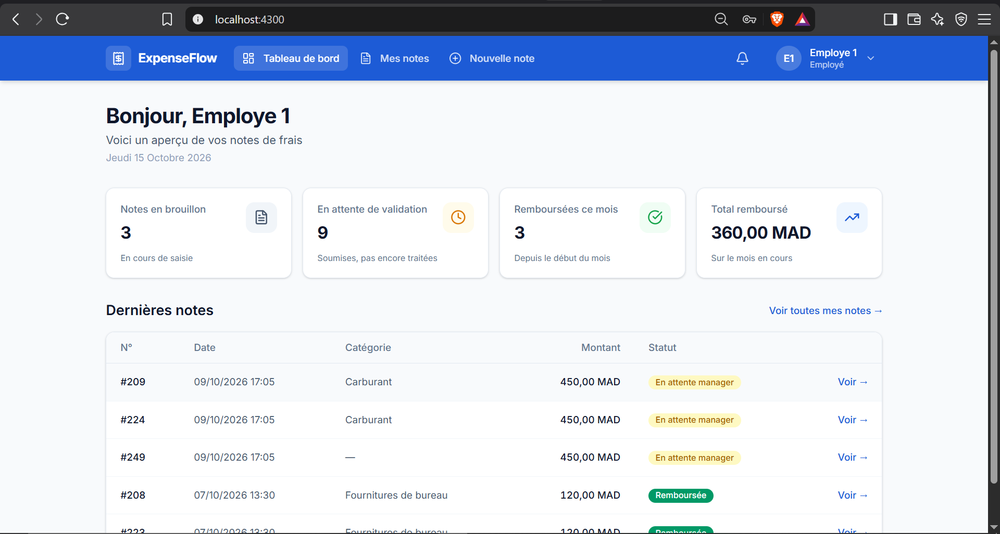
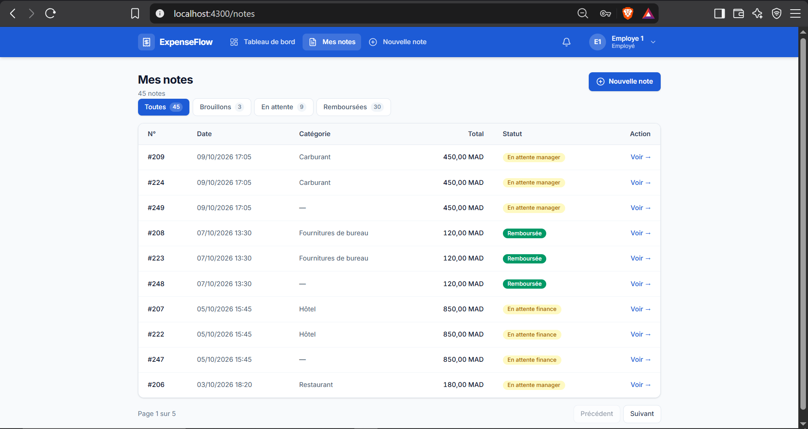
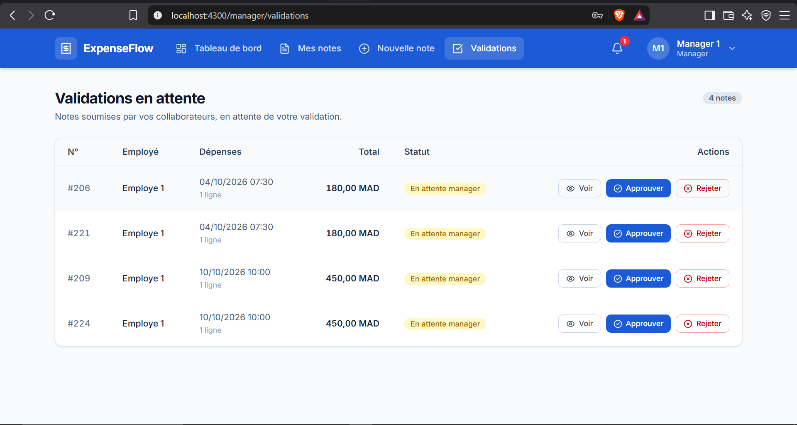

# ExpenseFlow

Application web de gestion des notes de frais en entreprise. L'employé saisit sa dépense en une phrase, le formulaire se remplit automatiquement, puis la note passe par la validation du manager et le remboursement par la finance.

Projet personnel réalisé dans le cadre de mon Master 2 Systèmes d'Information et IA.



## Fonctionnalités

- Connexion sécurisée avec quatre rôles : employé, manager, finance et administrateur
- Circuit de validation complet, de la création de la note jusqu'au remboursement
- Pré-remplissage du formulaire à partir d'une phrase en langage courant
- Plafonds de dépenses par catégorie
- Notifications dans l'application
- Gestion des comptes par l'administrateur

## Technologies

| | |
|---|---|
| Backend | Java, Spring Boot, Spring Security |
| Base de données | PostgreSQL, Flyway |
| Frontend | React, Vite, Tailwind CSS |
| IA | Groq |
| Tests | JUnit, Mockito, Testcontainers |
| Déploiement | Docker Compose |

## Installation

Prérequis : Docker.

```bash
git clone https://github.com/otman-aml/expenseflow.git
cd expenseflow
cp .env.example .env
docker compose up -d --build
```

Avant de lancer, renseignez `GROQ_API_KEY` et `JWT_SECRET` dans le fichier `.env`.

L'application est ensuite disponible sur http://localhost:4300 et la documentation de l'API sur http://localhost:8090/swagger-ui/index.html.

## Comptes de démonstration

Pour charger les données d'exemple :

```bash
docker exec -i expenseflow-postgres psql -U expenseflow -d expenseflow \
  < backend/src/main/resources/db/seed/demo-data.sql
```

Mot de passe de tous les comptes : `Password123!`

| Rôle | Email |
|---|---|
| Employé | employee@expenseflow.ma |
| Manager | manager@expenseflow.ma |
| Finance | finance@expenseflow.ma |
| Administrateur | admin@expenseflow.ma |

## Tests

```bash
cd backend
./mvnw test
```

Docker doit être lancé, les tests utilisent Testcontainers.

## Captures d'écran

| | |
|---|---|
|  |  |
|  |  |

## Documentation

Les diagrammes UML sont dans [`docs/diagrams/png/`](docs/diagrams/png/) et le guide de déploiement dans [`DEPLOYMENT.md`](DEPLOYMENT.md).

## Auteur

Otman AMAL· 
[otman.amal01@gmail.com](mailto:otman.amal01@gmail.com)
